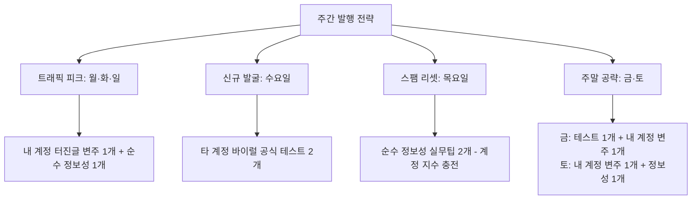
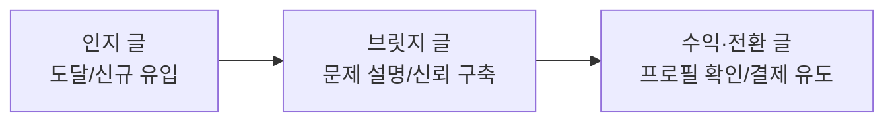

# 🔥 스레드 조회수 폭발 바이럴 공식 가이드 & 실전 운영 매뉴얼

> **운영 계정:** `@automad.ai` (오토마드) / `@vibemad.ai` (바이브마드)  
> **핵심 메커니즘:** 본인 계정 초대박 검증 후킹(10만, 9.3만, 8.9만) 변주 + 타 계정 벤치마킹 테스트(94장 슬라이드) + 계정 보호용 순수 정보성 실무팁 결합  
> **운영 툴:** 버퍼(Buffer) 예약 발행 시스템 100% 최적화 슬롯 적용

---

## 📅 [확정] 주간 발행 매트릭스 & 버퍼(Buffer) 슬롯 공식

계정 피로도 해소, 스팸 알고리즘(섀도밴) 방지, 그리고 폭발적인 조회수를 동시에 달성하는 주간 편성표입니다.

| 요일 | 1차 슬롯 (오전) | 2차 슬롯 (오후/저녁) | 해당 요일의 전략 목적 |
| :--- | :--- | :--- | :--- |
| **월요일** | **[내 계정 터진글 변주]** (08:20 AM) | **[순수 정보성 실무팁]** (06:10 PM) | 월요병 타깃 대형 트래픽 폭발 + 저녁 쿨다운 저장 |
| **화요일** | **[내 계정 터진글 변주]** (08:13 AM) | **[순수 정보성 실무팁]** (06:07 PM) | 화요일 10만 출근길 재현 + 실무 팁 저장 |
| **수요일** | **[타 계정 벤치마킹 테스트]** (07:40 AM) | **[타 계정 벤치마킹 테스트]** (08:24 PM) | 신규 바이럴 공식 발굴 및 A/B 테스트 |
| **목요일** | **[순수 정보성 실무팁 1]** (08:11 AM) | **[순수 정보성 실무팁 2]** (07:33 PM) | **계정 정지 방지 & 스팸 초기화 & 저장(북마크) 극대화** |
| **금요일** | **[타 계정 벤치마킹 테스트]** (08:25 AM) | **[내 계정 터진글 변주]** (06:15 PM) | 불금 퇴근길(18:15 누적 8.9만 슬롯) 킬러 배치 |
| **토요일** | **[내 계정 터진글 변주]** (08:24 AM) | **[순수 정보성 실무팁]** (07:35 PM) | 주말 아침 기상 폰 타임(2.5만 검증) 공략 |
| **일요일** | **[내 계정 터진글 변주]** (01:35 PM) | **[순수 정보성 실무팁]** (07:06 PM) | 주말 마무리 여유 트래픽 공략 (08:38 PM 필요시 추가) |

---

## 🏆 [자산 1] 내 계정에서 검증된 3대 초대박 후킹 치트키

내 계정에서 실제로 8만~10만 조회수를 터뜨린 원형(Original) 후킹입니다. 이 3대 후킹의 첫 1~3줄 뼈대는 그대로 유지하고, 내부 예시(프롬프트, 템플릿, 수치)만 바꿔서 무한 변주합니다.

### ① [1위 / 10만 뷰] 절박함 & 생계형 프롬프트 후킹
* **검증 실적:** 10만 회 (10/20), 2.1만 회 (11/01), 1.3만 회 (21시간)
* **원형 후킹:**
  > 당장 퇴사하고 통장 잔고 바닥났는데
  > 월세, 카드값, 생활비 등 나갈 돈은 산더미라
  > 이번 달 안에 무조건 부수입 100만 원을 만들어야 한다면
  > 저는 고민 없이 이렇게 할 겁니다.
  > 1. [도구]를 연다.
  > 2. 아래 프롬프트를 그대로 복사해서 붙여넣는다.
  > [소재] 프롬프트 N종: 1/N

### ② [2위 / 9.3만 뷰] 비개발자 충격 고백 & 2억 매출 후킹
* **검증 실적:** 9.3만 회 (10/05, 월요일 12:35 PM)
* **원형 후킹:**
  > 솔직히 고백함. 나 코딩 1도 모르는 비개발자임.
  > 컴퓨터로 카톡 치고 쿠팡 쇼핑하는 게 전부였음.
  > 근데 [바이브코딩/AI] 하나 파고들어서
  > 3개월 만에 하반기 외주 매출 2억 찍었음.
  > 수백만 원짜리 코딩 부트캠프 다닐 필요 전혀 없음.
  > 초보들이 첫 주에 포기하는 이유 딱 3개만 피하면
  > 누구나 주말 이틀 써서 첫 외주 50만 원 입금받을 수 있음: 1/N

### ③ [3위 / 8.9만 뷰 & 최고 반응] Claude 8억 누적 + 직격 일침 후킹
* **검증 실적:** 8.9만 회 (10/30, 금요일 06:15 PM / **좋아요 364, 리포스트 16, 답글 137, 저장 155**)
* **원형 후킹:**
  > 나는 Claude가 처음 나왔을 때부터 써왔고
  > 지금까지 AI개발로 번 돈만 누적 8억이 넘는다.
  > 근데 AI로 외주 부업한다는 사람들 90%는 아직도 통장 잔고가 0원임.
  > Claude한테 '홈페이지 예쁘게 만들어줘' 같은 초딩 질문만 던지면서 코드랑 씨름하고 있으니까.
  > AI로 진짜 돈을 쓸어 담으려면 이 3가지만 뜯어고쳐야 함: 1/N

---

## 🧪 [자산 2] 타 계정 벤치마킹 검증 템플릿 (94장 슬라이드 분석 기반)

수요일(2개) 및 금요일(1개)에 신규 무기 발굴을 위해 테스트할 바이럴 공식입니다:

* **[공식 1] 3無 5줄 공식 (`@joyday_0912` 27만 뷰):**
  > 스마트폰 + AI = 첫 달에 부업으로 100 꽂는 법
  > 코딩 공부 필요 없음
  > 디자인 학원 필요 없음
  > 영업 스트레스 필요 없음
  > 첫 달 100만 원 끝내는 프롬프트 8종 대공개 👇
  > (저장하고 따라 해 저장 귀찮으면 프로필 확인) 1/N
* **[공식 2] 도발 & 손실회피 팩폭 (`@quitting_time_lab` 75만 뷰):**
  > 어차피 알려줘도 안 하니까 그냥 다 공개함.
  > AI로 외주 시작했는데 첫 달에 100도 못 벌고 있으면 딱 이 10가지만 체크하셈.
  > 99%는 3번에서 막혀서 포기함: 1/N
* **[공식 3] 충격 비교 & 구시대 저격 (`@playto876` 35만 뷰):**
  > 피그마 잡고 3일 밤새우는 분, 아직도 없으시죠?
  > 컴맹 비전공자도 10분 만에 모바일 1페이지 뽑아서 50만 원 입금받는 시대입니다.
  > 외주 단가 2배로 올려주는 치트키 5가지: 1/N

---

## 🛡️ [자산 3] 계정 보호 및 저장(북마크) 폭발 순수 정보성 실무팁

목요일(전일 2개) 및 월·화·토·일(저녁 각 1개)에 배치해 계정 정지를 방지하고 점수를 끌어올리는 검증된 실무 주제들입니다:

1. **외주 단가 2배 올려주는 무료 웹 디자인·애니메이션 사이트 7선:**  
   (OriginKit, Magic UI, Aceternity UI, Uiverse, 21st.dev, 3dicons, Godly)
2. **모든 기기에서 세련되게 뜨는 상업용 무료 한글 웹폰트 3대장:**  
   (Pretendard, Noto Sans, Gmarket Sans) - *2.4만 뷰 실전 검증*
3. **자고 일어났더니 카드값 500만 원? API Key 탈취 원리와 1분 예방법:**  
   (환경변수 격리 및 깃허브 시크릿 방어) - *2.5만 뷰 실전 검증*
4. **모바일 사파리 100vh 주소창 가림 버그 1줄 해결법 (dvh 최적화)**
5. **아이폰 모바일 입력창(input) 터치 시 강제 확대(zoom-in) 현상 방지법 (font-size 16px 원칙)**
6. **홈페이지 로딩 속도 3배 빨라지는 무료 이미지 WebP 자동 압축 팁**

---

## 🚫 [절대 금기 사항 5계명]

1. **본문 마크다운 별표(`**`) 100% 금지:** 스레드 모바일 앱에서 깨져서 노출되므로 일반 텍스트로만 작성.
2. **사기성 마케팅 어필 금지:** "매출 10배", "전환율 폭발" 등 클라이언트가 신뢰하지 못할 과장 배제.  
   👉 **"모바일 버그 없는 완성도 + 세련된 디자인 퀄리티 + 유사 업종 제작 경험"**으로만 어필.
3. **아웃바운드 영업(콜드콜, DM, 카톡 발품) 전면 금지:**  
   👉 크몽·스레드에 세련된 데모 사이트를 올려두고 **클라이언트가 먼저 찾아오는 100% 인바운드 수주**만 다룸.
4. **금지 단어 절대 사용 금지:**  
   `치킨게임`, `소상공인`, `사장님`, `대표님`, `가게`, `손님`, `블로그` 전면 배제 (대신 클라이언트, 의뢰인, 기업, 자영업자, 크몽·스레드 사용).
5. **사족 에세이/소설식 전개 금지:** 첫 줄은 무조건 5줄 이내 초단문 훅으로 독자 시선을 낚아챌 것.

---
* 본 가이드 및 시스템에 포함된 **쿠팡파트너스, 제휴 링크(Affiliate), 실물 상품 소싱** 관련 내용은 **사용자가 명시적으로 질문하거나 관련 프롬프트/요청을 할 때만 활용**합니다.
* **평소 스레드 글 작성, 분석, 템플릿 적용 시에는 쿠팡파트너스/상품 소싱을 완전히 배제**하며, **IT 외주 비즈니스, 1인 에이전시, 지식 콘텐츠 및 순수 바이럴 퍼널**을 기본 전제로 동작합니다.

## ⚠️ [필수 원칙 2] 직관적 비즈니스 용어 준수 (비유 및 호칭 금지)
* ❌ **배제할 표현:** '소상공인', '가게', '손님', '식당 비유', '치킨게임' 및 **'사장님', '대표님'** 같은 호칭 전면 배제. (누구나 바로 이해할 수 있는 직관적인 표현 사용)
* ⭕ **필수 권장 용어:** **클라이언트, 의뢰인, 기업, 중소기업, 자영업자, B2B, B2C, 가격경쟁**.
* 외주 상대방을 지칭할 때는 무조건 **'클라이언트'** 또는 **'의뢰인'**으로 통일합니다.

## ⚠️ [필수 원칙 3] 100% 인바운드 수주 원칙 (아웃바운드 / DM 제안 금지)
* ❌ **배제할 내용:** 카톡이나 인스타 DM, 이메일로 먼저 콜드 세일즈 제안을 보내는 아웃바운드 영업 방식 전면 배제.
* ⭕ **실제 비즈니스 구조:** **포트폴리오와 채널(크몽, 블로그, 스레드 등)을 통해 클라이언트가 먼저 찾아와 문의를 남기게 만들고(인바운드)**, 들어온 문의에 대해 주도권을 잡고 질문을 던져 프로토타입과 비교견적서로 미팅에서 계약을 체결하는 시스템만 다룹니다.

## ⚠️ [필수 원칙 4] 개발 툴 언급 기준 & 팩트 엄수 (임의 창작 및 외주 작업물 공개 금지)
* ❌ **스레드 본문 텍스트 내 `**` 별표(볼드 마크다운) 전면 금지:** 스레드 모바일 앱에서는 `**`가 볼드로 변환되지 않고 그대로 지저분하게 노출되므로, "저장해두세요", "프로필 확인ㄱㄱ" 등 본문 어디에도 `**`를 쓰지 않고 깔끔한 일반 텍스트로 작성합니다.
* ❌ **사용하지 않는 툴 언급 전면 금지:** `Supabase`, `Vercel`, `Cursor` 등 실제로 쓰지 않는 도구는 스레드 원고에 절대 넣지 않습니다.
* ❌ **진부하거나 당연한 기술 팁 배제:** `.env` 파일에 시크릿 키 격리하기 등 요즘 AI 코딩 도구가 알아서 기본 처리해 주는 당연하고 초보적인 팁은 스레드 정보성 글이나 캘린더에 넣지 않습니다. (대신 AI 티 벗기는 디자인 교정, 모바일 터치 최적화, 스팸 방어 등 실질적 가치가 높은 팁만 다룸)
* ❌ **유료 전자책 노하우(Replit / Neon DB) 스레드 노골적 노출 금지:** 실제 개발은 `Replit(레플릿)`과 내장 `Neon DB`로 진행하지만, 이는 유료 전자책의 핵심 노하우이므로 스레드 공개 글에서는 가급적 툴 이름을 직접 까발리지 않고 **'AI', 'AI 코딩 도구', 'DB'**로 지칭합니다.
* ❌ **외주 결과물 공개 및 허위 지어내기 금지:** 계정에서 실제 외주 작업물 캡처를 보여준다는 표현이나 없는 사실을 임의로 지어내지 않습니다.
* ⭕ **정보성 글 리서치 기준:** 정보성/꿀팁 글을 작성할 때는 먼저 인터넷 검색을 통해 실제 실무 팩트를 확인하며, **[일반 웹 검색 방법 vs 깃허브 오픈소스]** 중 독자에게 실제로 더 편하고 유용한 방법을 채택해 작성합니다.
* ⭕ **첫 줄 후킹 초단축 원칙:** 첫 타래(`1/3`)의 후킹 문구는 사족을 빼고 **1~3줄 이내의 강력하고 짧은 문장**으로만 작성합니다.

---

## 1. 스레드 조회수가 폭발하는 핵심 원리 3요소

### ① 표면적 도파민 트리거: `[누구나 + 쉽게 + 돈 번다]`
* **누구나 (타깃):** 비개발자, 문과생, 컴맹, 애 보는 엄마, 퇴근한 직장인 (진입장벽 박살)
* **쉽게 (행동):** 복붙 10분 컷, 감독질만, 지피티 파일 2개 첨부, 주말 1시간
* **돈 번다 (보상):** 단기 50만 원 입금, 3집 150만 원, 월 관리비 자동화, 300만 원짜리 제작

### ② 사기 글로 전락하지 않는 비결: `[극사실적 디테일]`
"월 1,000만 원 번다" 같은 뜬구름 소리는 외면받습니다.
* *"쇼핑몰 만들지 마라 자멸한다, 인스타 링크 1페이지 만들어라"*
* *"에이전시 300만 원짜리를 지피티에 design.md, 기능명세서.md 던져서 9분 컷 냈다"*
* *"제작비 50만 원 + 월 서버관리비 5만 원"*
**현업의 냄새가 물씬 나는 리얼한 디테일이 들어가야 독자가 '어? 이거 진짜 되겠는데?' 하고 신뢰합니다.**

### ③ 알고리즘을 밀어 올리는 지표: `[저장(Save) & 체류시간]`
* 스레드 알고리즘은 **'저장(북마크)'**과 **'타래 끝까지 읽기'**에 가장 높은 가중치를 둡니다.
* "지금 당장은 바빠도 주말에 꼭 써먹어야지", "이 프롬프트/템플릿은 잃어버리면 손해다"라는 손실회피 심리를 자극해 저장을 누르게 만듭니다.

---

## 2. 반응을 부르는 독자 심리 분석

| 행동 | 독자의 무의식 속 심리 |
| :--- | :--- |
| **조회 (클릭)** | *"나만 퇴근하고 배민 뛰면서 바보같이 사나? 나 같은 컴맹도 진짜 가능한가?" (FOMO + 일말의 희망)* |
| **저장 (북마크)** | *"지금은 귀찮지만 주말에 무조건 써먹어야지. 저장해두면 나도 부업 준비 끝난 것 같음." (손실회피 + 대리만족)* |
| **댓글 (참여)** | *"진짜 저도 되나요? 어떻게 시작해요? 더 떠먹여 주세요." (검증 욕구 + 의존 심리)* |

---

## 3. 콘텐츠 역할별 포트폴리오 (계정 운영 루프)

모든 글을 똑같은 목적으로 쓰면 계정이 무너집니다. 글마다 **명확한 역할(Role)**을 부여합니다.

1. **인지 글 (도달·확산형 / 약 40~50%)**
   * **목표:** 조회수, 재게시, 신규 팔로우 유입
   * **특징:** 대중적인 공감대, 퇴사/부업 페인포인트, 기존 방식의 불합리 저격, 논쟁거리
2. **브릿지 글 (신뢰·문제해결형 / 약 30~40%)**
   * **목표:** 댓글, 저장(북마크), 프로필 방문 유도
   * **특징:** 유용한 정보, 선택 기준 3가지, 초보가 자주 하는 실수, 문제의 근본 원인 분석
3. **수익·전환 글 (행동 유도형 / 약 20%)**
   * **목표:** 프로필 링크 클릭, 전자책/서비스 확인
   * **특징:** 구체적인 결과물 제시, "무엇을 확인할지" 명확한 이유 제시 (`프로필 확인ㄱㄱ`)

---

## 4. 실전 카피라이팅 & 글쓰기 세부 공식

### ① 스크롤을 멈추게 만드는 첫 줄(후킹) 5대 메커니즘 (조회수 3,000+ 실전 검증)
긴 설명 없이 **모바일 화면 첫 1~2줄에서 독자의 시선을 낚아채는 압축 훅**을 사용합니다. 글마다 서로 다른 형식을 유기적으로 배분합니다:

* **메커니즘 1 [감정 폭발/비교형]:** 남들의 비효율·고가 외주를 보고 즉각적인 감정 표출
  * 예: *"오늘 스레드에서 '병원 랜딩페이지 제작 300만 원'에 파는 글 보고 솔직히 헛웃음 나왔음."*
* **메커니즘 2 [도발 & 팩폭형]:** 대중의 상식을 의문형으로 도발 후 바로 다음 줄에서 차가운 팩폭
  * 예: *""AI로 10분 만에 사이트 만든다"는 소리에 현직 개발자들이 코웃음 치는 이유? 배포도 모르고 코드만 덜렁 뽑아놓으니까."*
* **메커니즘 3 [단두대 라벨형]:** 딱 1줄 콜론(:)으로 대상을 지목하여 상대적 박탈감과 FOMO 극대화
  * 예: *"이 시각 가장 손해 보고 있는 사람: 퇴근하고 시급 1만 원 벌겠다고 배민 뛰는 직장인. 남들은 자동사냥 돌리고 있는데."*
* **메커니즘 4 [벼랑 끝 생존형]:** 원초적인 생존 위기와 고정비 지출을 2줄로 직격
  * 예: *"당장 퇴사하고 수입이 끊기고, 월세/카드값 등 나갈 돈은 많은데 몇 개월 안에 수입 만들어야 한다면"*
* **메커니즘 5 [현장 팩폭형]:** 누구나 공감하는 구체적인 고생 장면에 '안타까움'으로 타격
  * 예: *"퇴근하고 배민 뛰거나 쿠팡 알바 뛰면서 시급 1~2만 원에 몸 갈아 넣는 직장인들 보면 너무 안타까움."*
> **⚠️ 첫 줄 작성 절대 금기:** 첫 문단이 3~4줄로 길어지는 설명조/훈계조는 스크롤 이탈의 주원인입니다. 반드시 1~2줄 컷으로 시선을 멈추게 하세요.

### ② 본문 4단 전개 구조
글이 길어지고 늘어지는 것을 방지하기 위해 **4칸 구조**로 압축합니다:
$$\text{문제} \longrightarrow \text{이유} \longrightarrow \text{해결} \longrightarrow \text{결과}$$
* **AI 티 벗기기:** "혁신적, 최고의, 탁월한" 같은 빈 형용사 전면 삭제.
* 한 문단은 1~2문장으로 호흡을 짧게 유지하고, 구체적 장면 하나를 반드시 포함.

### ③ 댓글을 폭발시키는 끝문장 원칙 (1초 답변 유도)
* ❌ *"여러분 생각은 어떠세요?"* (답변하기 너무 막연해서 이탈함)
* ⭕ **1초 만에 답할 수 있는 좁고 명확한 질문:**
  * **선택형:** "A랑 B 중에 너라면 뭐 고름?"
  * **경험형:** "이거 겪어본 사람 나뿐임?"
  * **추천형:** "이거 대체할 수 있는 거 있으면 알려줘."
  * **숫자형:** "다들 외주 첫 미팅 때 몇 분 정도 상담함?"

### ④ CTA (행동 유도)의 원칙 & 말투 다양화
* "사세요", "다운받으세요" 같은 직접적인 판매 압박 대신 **"무엇을 확인할지" 이유**를 제시합니다.
* 매 글마다 똑같은 문장만 반복하면 봇/매크로처럼 보이므로, **글의 페르소나와 상황에 맞춰 다양한 구어체로 변주**합니다:
  * 쿨한 직진형: `프로필 확인ㄱㄱ` / `프로필 확인해봐!`
  * 진정성 행동형: `프로필에 있으니까 저장하고 꼭 실천해라` / `이번 주말에 꼭 써먹어봐`
  * 퇴근/일상형: `프로필에 다 정리해 뒀으니 오늘 퇴근길에 꼭 읽어봐`
  * 호기심 유도형: `더 자세한 로드맵은 프로필에서 바로 확인 가능함`
  * 친절형: `프로필에 차근차근 정리해 뒀으니 편하게 읽어보세요`

---

## 5. 데이터 기반 운영 체제 (진단 & 실험 루프)

> *"소셜 데이터는 변동이 큽니다. 글 하나에 일희일비하지 않고 '숫자'로 진단하고 시스템을 개선합니다."*

### ① 퍼널 진단 매트릭스
| 현상 | 원인 진단 | 개선 액션 |
| :--- | :--- | :--- |
| **조회수가 낮다** | 첫 줄(후킹), 소재, 첫 장면 문제 | 훅 유형(고백/손해/비교) 변경 테스트 |
| **조회는 높은데 저장이 낮다** | 소장 가치(템플릿, 프롬프트, 정보성) 부족 | 빈칸 채우기 형식이나 명확한 체크리스트 보강 |
| **조회는 높은데 클릭이 낮다** | 본문과 CTA의 연결고리(브릿지) 약함 | "프로필에서 무엇을 확인할지" 명분 강화 |
| **클릭은 높은데 전환이 낮다** | 랜딩페이지/상품 페이지 불일치 | 상세페이지 카피, 가격대, 옵션 검토 |

### ② 기준선(Baseline)과 A/B 테스트 규칙
* **기준선 잡기:** 최근 30개 글의 **중앙값(Median)**을 평소 실력으로 고정하고, 상위 20%의 특징을 분석.
* **한 번에 변수 1개만 변경:** 훅, 본문, 시간대, 이미지를 한 번에 바꾸면 무엇 때문에 성과가 났는지 알 수 없음. (훅만 바꾸거나, CTA만 바꾸는 실험)
* **이상치에 흔들리지 않기:** 어쩌다 터진 100만 조회수 하나에 계정 방향 전체를 틀지 않고, **재현 가능한 요소**만 운영 규칙으로 채택.

---

## 6. 엄수된 비즈니스 단가 및 실무 기준

* **현실적인 단가 기준:**
  * 일반 업체/기업 홈페이지: 건당 **100 ~ 150만 원**
  * 병원 / 전문직(변호사, 세무사 등): 건당 **300만 원 이상**
  * 고정 수입: 월 유지보수/서버 관리비 **5 ~ 10만 원**
* **개발자도 딴지 못 거는 실무 워크플로우:**
  * "HTML 하나로 끝" 같은 허위 과장 배제
  * 실제 도메인(가비아 DNS), 고객 문의 연동(카톡/웹훅), 디자인 시스템(DESIGN.md), 반응형 레이아웃, PG 심사 기준 등 진짜 작동하는 실무 기준 반영

---

## 7. 워크스페이스 폴더 구성 안내 (계정별 원고 분리 운영)

* [00_발행완료_원고_및_중복방지_기록.md](file:///c:/Users/user/OneDrive/Desktop/%EC%8A%A4%EB%A0%88%EB%93%9C%20%EC%9E%90%EB%8F%99%ED%99%941019/threads_viral_formula/00_%EB%B0%94%ED%96%89%EC%99%84%EB%A3%8C_%EC%9B%90%EA%B3%A0_%EB%B0%8F_%EC%A4%91%EB% Bok%EB%B0%A9%EC%A7%80_%EA%B8%B0%EB%A1%9D.md) : 실시간 수시 발행 원고 아카이빙 및 향후 주간 캘린더 소재/문장 중복 영구 방지 블랙리스트
* [01_만능_바이럴_템플릿.md](file:///c:/Users/user/OneDrive/Desktop/%EC%8A%A4%EB%A0%88%EB%93%9C%20%EC%9E%90%EB%8F%99%ED%99%941019/threads_viral_formula/01_%EB%A7%8C%EB%8A%A5_%EB%B0%94%EC%9D%B4%EB%9F%B4_%ED%85%9C%ED%94%8C%EB%A6%BF.md) : 두 계정 공통으로 사용하는 빈칸 채우기용 표준 타래 구조 템플릿 (템플릿 1~14)
* **`01_오토마드_automad/` (`@automad.ai` 전용 원고함 - 1인 에이전시/직장인/개발·수주 시스템 중심)**
  * [00_계정_컨셉_및_프로필.md](file:///c:/Users/user/OneDrive/Desktop/%EC%8A%A4%EB%A0%88%EB%93%9C%20%EC%9E%90%EB%8F%99%ED%99%941019/threads_viral_formula/01_%EC%98%A4%ED%86%A0%EB%A7%88%EB%93%9C_automad/00_%EA%B3%84%EC%A0%95_%EC%BB%A8%EC%85%89_%EB%B0%8F_%ED%94%84%EB%A1%9C%ED%95%84.md)
  * [01_유입_및_타깃별_원고.md](file:///c:/Users/user/OneDrive/Desktop/%EC%8A%A4%EB%A0%88%EB%93%9C%20%EC%9E%90%EB%8F%99%ED%99%941019/threads_viral_formula/01_%EC%98%A4%ED%86%A0%EB%A7%88%EB%93%9C_automad/01_%EC%9C%A0%EC%9E%85_%EB%B0%8F_%ED%83%80%EA%B9%83%EB%B3%84_%EC%9B%90%EA%B3%A0.md)
  * [02_리드마그넷_무료자료_유도.md](file:///c:/Users/user/OneDrive/Desktop/%EC%8A%A4%EB%A0%88%EB%93%9C%20%EC%9E%90%EB%8F%99%ED%99%941019/threads_viral_formula/01_%EC%98%A4%ED%86%A0%EB%A7%88%EB%93%9C_automad/02_%EB%A6%AC%EB%93%9C%EB%A7%88%EA%B7%B8%EB%84%B7_%EB%AC%B4%EB%A3%8C%EC%9E%90%EB%A3%8C_%EC%9C%A0%EB%8F%84.md)
  * [03_순수_정보성_실무팁.md](file:///c:/Users/user/OneDrive/Desktop/%EC%8A%A4%EB%A0%88%EB%93%9C%20%EC%9E%90%EB%8F%99%ED%99%941019/threads_viral_formula/01_%EC%98%A4%ED%86%A0%EB%A7%88%EB%93%9C_automad/03_%EC%88%9C%EC%88%98_%EC%A0%95%EB%B3%B4%EC%84%B1_%EC%8B%A4%EB%AC%B4%ED%8C%81.md)
  * **`04_주간_발행_캘린더/`** (주차별 발행 예약 관리 폴더)
    * `11월_1주차_예약완료.md` (예약 완료 보관 원고)
    * `11월_2주차.md` (다음 주 발행 대기 신규 원고)
* **`02_바이브마드_vibemad/` (`@vibemad.ai` 전용 원고함 - 주부/경단녀/비전공자/홈페이지 부업 중심)**
  * [00_계정_컨셉_및_프로필.md](file:///c:/Users/user/OneDrive/Desktop/%EC%8A%A4%EB%A0%88%EB%93%9C%20%EC%9E%90%EB%8F%99%ED%99%941019/threads_viral_formula/02_%EB%B0%94%EC%9D%B4%EB%B8%8C%EB%A7%88%EB%93%9C_vibemad/00_%EA%B3%84%EC%A0%95_%EC%BB%A8%EC%85%89_%EB%B0%8F_%ED%94%84%EB%A1%9C%ED%95%84.md)
  * [01_유입_및_타깃별_원고.md](file:///c:/Users/user/OneDrive/Desktop/%EC%8A%A4%EB%A0%88%EB%93%9C%20%EC%9E%90%EB%8F%99%ED%99%941019/threads_viral_formula/02_%EB%B0%94%EC%9D%B4%EB%B8%8C%EB%A7%88%EB%93%9C_vibemad/01_%EC%9C%A0%EC%9E%85_%EB%B0%8F_%ED%83%80%EA%B9%83%EB%B3%84_%EC%9B%90%EA%B3%A0.md)
  * [02_리드마그넷_무료자료_유도.md](file:///c:/Users/user/OneDrive/Desktop/%EC%8A%A4%EB%A0%88%EB%93%9C%20%EC%9E%90%EB%8F%99%ED%99%941019/threads_viral_formula/02_%EB%B0%94%EC%9D%B4%EB%B8%8C%EB%A7%88%EB%93%9C_vibemad/02_%EB%A6%AC%EB%93%9C%EB%A7%88%EA%B7%B8%EB%84%B7_%EB%AC%B4%EB%A3%8C%EC%9E%90%EB%A3%8C_%EC%9C%A0%EB%8F%84.md)
  * [03_순수_정보성_실무팁.md](file:///c:/Users/user/OneDrive/Desktop/%EC%8A%A4%EB%A0%88%EB%93%9C%20%EC%9E%90%EB%8F%99%ED%99%941019/threads_viral_formula/02_%EB%B0%94%EC%9D%B4%EB%B8%8C%EB%A7%88%EB%93%9C_vibemad/03_%EC%88%9C%EC%88%98_%EC%A0%95%EB%B3%B4%EC%84%B1_%EC%8B%A4%EB%AC%B4%ED%8C%81.md)
  * **`04_주간_발행_캘린더/`** (주차별 발행 예약 관리 폴더)
    * `11월_1주차_예약완료.md` (예약 완료 보관 원고)
    * `11월_2주차.md` (다음 주 발행 대기 신규 원고)
* **`03_내계정_터진글_모음/` (실제 조회수 폭발·검증된 바이럴 성공 원고 아카이빙 금고)**
  * [00_터진글_분석_및_기록가이드.md](file:///c:/Users/user/OneDrive/Desktop/%EC%8A%A4%EB%A0%88%EB%93%9C%20%EC%9E%90%EB%8F%99%ED%99%941019/threads_viral_formula/03_%EB%82%B4%EA%B3%84%EC%A0%95_%ED%84%B0%EC%A7%84%EA%B8%80_%EB%AA%A8%EC%9D%8C/00_%ED%84%B0%EC%A7%84%EA%B8%80_%EB%B6%84%EC%84%9D_%EB%B0%8F_%EA%B8%B0%EB%A1%9D%EA%B0%80%EC%9D%B4%EB%93%9C.md)
  * [01_오토마드_터진글.md](file:///c:/Users/user/OneDrive/Desktop/%EC%8A%A4%EB%A0%88%EB%93%9C%20%EC%9E%90%EB%8F%99%ED%99%941019/threads_viral_formula/03_%EB%82%B4%EA%B3%84%EC%A0%95_%ED%84%B0%EC%A7%84%EA%B8%80_%EB%AA%A8%EC%9D%8C/01_%EC%98%A4%ED%86%A0%EB%A7%88%EB%93%9C_%ED%84%B0%EC%A7%84%EA%B8%80.md)
  * [02_바이브마드_터진글.md](file:///c:/Users/user/OneDrive/Desktop/%EC%8A%A4%EB%A0%88%EB%93%9C%20%EC%9E%90%EB%8F%99%ED%99%941019/threads_viral_formula/03_%EB%82%B4%EA%B3%84%EC%A0%95_%ED%84%B0%EC%A7%84%EA%B8%80_%EB%AA%A8%EC%9D%8C/02_%EB%B0%94%EC%9D%B4%EB%B8%8C%EB%A7%88%EB%93%9C_%ED%84%B0%EC%A7%84%EA%B8%80.md)
